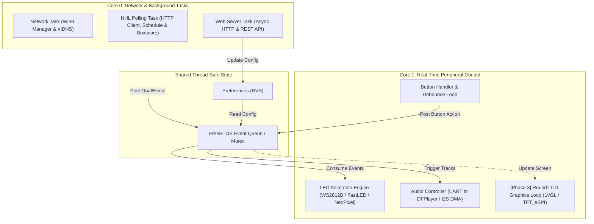
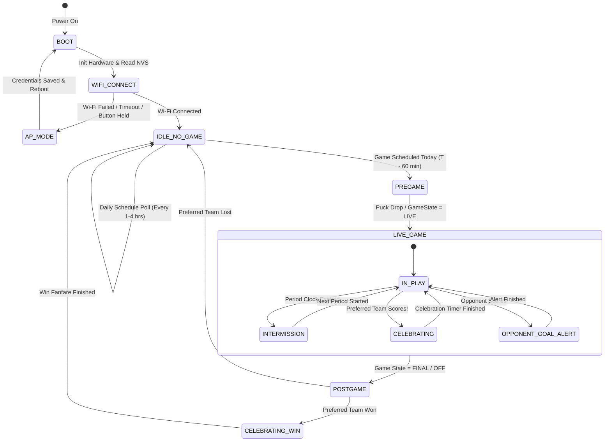

# System Architecture & Firmware Design

This document details the software architecture, state machine, task distribution, and design decisions for **Rob's NHL Goal Light**.

---

## 1. Architectural Philosophy

The firmware is designed around three primary constraints inherent to embedded ESP32 development:

1. **Non-Blocking Operation**: The LED ring animation and audio cues must run with zero stutter or frame drops, even while the ESP32 performs TLS/HTTPS handshakes and downloads JSON payloads.
2. **Memory Constrained HTTP/JSON Handling**: Modern NHL API responses can exceed 60KB–150KB (full play-by-play or boxscore). Loading an entire JSON document into a `String` on an ESP32 risks heap fragmentation and Out-Of-Memory (OOM) crashes. The firmware uses **chunked/streaming extraction** or filtered JSON parsing.
3. **Resilient Network Handling**: Wi-Fi drops, DNS failures, or NHL API timeouts must never lock up the device or interrupt local user interaction (button presses, web server, or running animations).

---

## 2. Multi-Core / FreeRTOS Task Allocation

On dual-core ESP32 variants (ESP32-D0WD, ESP32-S3), workload is distributed across both cores using FreeRTOS tasks:



> [!NOTE]
> For single-core variants (e.g. ESP32-C3 RISC-V), tasks run cooperatively or preemptively on Core 0 with prioritized FreeRTOS task scheduling. Time-critical LED updates occur in a fast periodic timer callback or high-priority task.

---

## 3. High-Level Game State Machine

The firmware transitions through states based on the NHL schedule and live game conditions:



### State Definitions

| State | Polling Interval | LED Behavior | Audio Behavior | Notes |
| :--- | :--- | :--- | :--- | :--- |
| **BOOT** | None | White sweep test | None | Hardware selftest |
| **AP_MODE** | None | Slow Yellow Beacon | None | Access Point `NHL-Goal-Light-Setup` active |
| **IDLE_NO_GAME** | 30–60 min | Off or Ambient Team Glow | Silent | Team does not play today |
| **PREGAME** | 5 min &rarr; 20 sec | Gentle breathing team colors | Optional siren at 5 min | Countdown to puck drop |
| **LIVE_IN_PLAY** | 3–5 seconds | Low ambient or dynamic status | Silent | Actively diffing scores |
| **INTERMISSION** | 45–60 seconds | Cool cyan / dim pulse | Short horn on period start | Power saving during intermissions |
| **CELEBRATING** | Suspended (or bg) | High-speed police strobe + beacon | Team Goal Horn + Song (MP3) | 10–20 sec duration |
| **OPP_GOAL** | 5 seconds | Brief red/amber flash (configurable) | Optional disappointed buzz | User-toggleable in web UI |
| **POSTGAME_WIN** | None | Victory rainbow or team pulse | Victory horn / arena song | Runs for 30s upon Final |

---

## 4. Adaptive Polling Engine

Constantly hitting the NHL API every 3 seconds 24/7 wastes power and risks API throttling. Inspired by the schedule and polling logic from [hockeygamebot/hgb_bot/loop.py](file:///Users/robtesta/Documents/Arduino/NHL%20Goal%20Light%2010.2026/hockeygamebot/hgb_bot/loop.py), we implement an **adaptive polling ramp**:

```
Time to Game / Condition                 Polling Interval
---------------------------------------------------------
No game scheduled today                  60 minutes
Game scheduled > 3 hours away            30 minutes
Game scheduled 1 to 3 hours away         15 minutes
Game scheduled 20 to 60 minutes away      5 minutes
Game scheduled 5 to 20 minutes away       1 minute
Game scheduled < 5 minutes away (PRE)    20 seconds
Game LIVE / CRIT (In play)                4 seconds
Intermission (clock.inIntermission)      45 seconds
Game FINAL / OFF                          Idle (next day check)
```

### Handling Score Corrections & Shootouts
1. **Initial Connection / Reboot Mid-Game**: When the ESP32 connects during an ongoing game, it captures an **initial snapshot** of current scores (`lastWatchedScore = currentScore`) without firing the horn.
2. **Score Decrement / Disallowed Goal**: If the NHL API corrects a score (e.g. high-sticking or offside overturn), `currentScore < lastWatchedScore`. The light updates internal state quietly without sounding the horn.
3. **Shootout Attempts**: In shootout mode, individual shot attempts do not change the game score until the final game-winning decider is logged. Shootout logic handles this gracefully.

---

## 5. Memory Management & HTTP Streaming

The ESP32 has limited contiguous RAM. Parsing a full 100KB JSON boxscore with `ArduinoJson` can allocate 30KB+ of dynamic memory.

### Optimized Parsing Strategies:
1. **Targeted Endpoint Selection**:
   - For schedule: `https://api-web.nhle.com/v1/club-schedule/{abbrev}/week/now` (very compact, ~2KB).
   - For live score: `https://api-web.nhle.com/v1/score/now` or `https://api-web.nhle.com/v1/gamecenter/{gameId}/boxscore`.
2. **Early Termination Stream Parsing**:
   - The game score in `/boxscore` is located at the top under `homeTeam` and `awayTeam`.
   - The HTTP client reads until it finds `"playerByGameStats"`, immediately disconnecting the socket to avoid downloading the remaining 80KB of player shift data!
3. **Filter-Based ArduinoJson (v7)**:
   - Using `DeserializationOption::Filter` allows `ArduinoJson` to discard all fields except `score`, `gameState`, and `clock`, reducing RAM footprint to < 500 bytes.

---

## 6. LED Animation Subsystem

Animations are computed on a frame-by-frame basis without blocking `delay()` calls:

- **Beacon Rotation**: Simulates a rotating halogen reflector inside a classic red beacon dome. Employs a Gaussian intensity falloff across adjacent LEDs on the ring.
- **Police Strobe**: Rapid alternating quad-flashes (left half / right half, or red/white).
- **Team Color Pulse**: Smooth sine-wave brightness breathing in the primary/secondary team colors.
- **Color Correction**: NeoPixels run in Gamma-corrected RGB (`FastLED` gamma or lookup tables) to ensure natural reds and deep blues.

---

## 7. Storage Subsystem (NVS & Preferences)

Device configuration is stored in non-volatile flash via `Preferences.h`:

```cpp
struct DeviceConfig {
  char wifi_ssid[33];
  char wifi_pass[65];
  char team_abbrev[4];         // e.g. "NYR"
  uint8_t brightness;          // 0 - 255 (default 180)
  uint8_t volume_index;        // 0 - 5 (mapped to DFPlayer levels)
  uint16_t horn_duration_ms;   // Duration of goal celebration (default 12000)
  bool alert_opponent_goals;   // Flash on opponent goals
  bool alert_power_plays;      // Alert when team gets a Power Play
  uint8_t led_effect_type;     // 0 = Beacon, 1 = Strobe, 2 = Pulse
};
```
