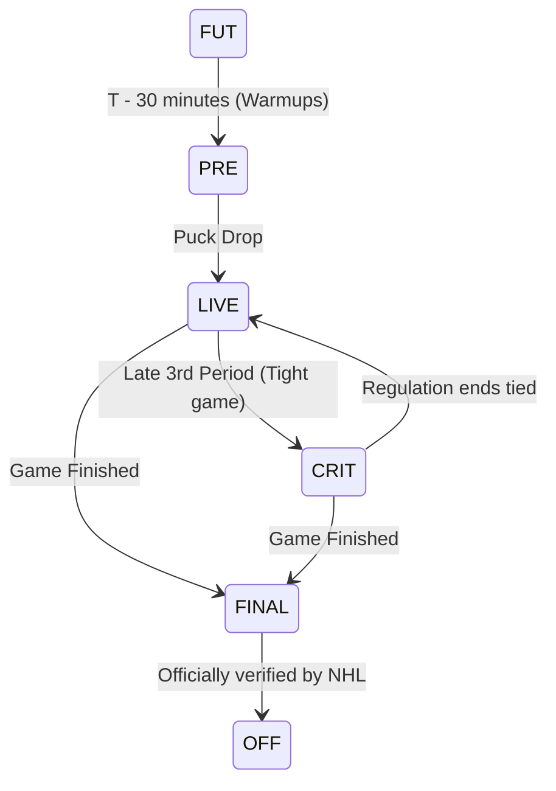

# NHL Public Web API Guide for ESP32

This guide documents the modern NHL Web API endpoints (`api-web.nhle.com/v1`), their payload structures, game state progressions, situation codes, and memory-safe parsing strategies on the ESP32.

---

## 1. API Architecture & Protocol

The NHL modern Web API is publicly accessible over HTTPS:
- **Base URL**: `https://api-web.nhle.com/v1`
- **Authentication**: None required (public endpoints).
- **Format**: JSON (UTF-8).
- **HTTP Headers**:
  - `User-Agent`: Set to a descriptive client identifier (e.g. `User-Agent: Rob-NHL-GoalLight/1.0`). Note that some endpoints block generic library user-agents like default `urllib` or return 403 if omitted.
  - `Accept`: `application/json`
  - `Accept-Encoding`: Ensure client requests uncompressed JSON (ESP32 lacks gzip streaming hardware decompression unless using `miniz`).

> [!IMPORTANT]
> **ESP32 TLS / SSL Verification**:
> In Arduino ESP32, use `WiFiClientSecure`. To avoid device bricking when seasonal SSL certificates renew, use `client.setInsecure()` or use the ESP32 BearSSL cert bundle.

---

## 2. Core Endpoints

### A. Team Weekly Schedule
```http
GET https://api-web.nhle.com/v1/club-schedule/{team_abbrev}/week/now
```
- **Example**: `https://api-web.nhle.com/v1/club-schedule/NYR/week/now`
- **Payload Size**: Compact (~2 KB to 8 KB).
- **Usage**: Used in `IDLE` state once every 1–4 hours to determine if the selected team plays today and get the scheduled puck drop UTC timestamp (`startTimeUTC`).
- **Key Fields**:
  - `games[].id`: Integer game ID (e.g., `2025020845`).
  - `games[].gameDate`: Hockey date (e.g., `"2026-10-16"`).
  - `games[].startTimeUTC`: ISO-8601 UTC timestamp (e.g., `"2026-10-16T23:00:00Z"`).
  - `games[].gameState`: Game state indicator (`FUT`, `PRE`, `LIVE`, `FINAL`).
  - `games[].homeTeam.abbrev` & `awayTeam.abbrev`: Opponent and venue context.

---

### B. Daily League Scoreboard
```http
GET https://api-web.nhle.com/v1/score/now
```
- **Payload Size**: Medium (~15 KB to 35 KB depending on number of games).
- **Usage**: Discovery of all games occurring right now across the league.
- **Key Fields**:
  - `games[].id`: 10-digit game identifier.
  - `games[].gameState`: Current state.
  - `games[].clock.timeRemaining`: Game clock (e.g., `"14:22"`).
  - `games[].clock.inIntermission`: Boolean indicating period intermission.
  - `games[].homeTeam.score` & `awayTeam.score`: Current score.

---

### C. Live Boxscore
```http
GET https://api-web.nhle.com/v1/gamecenter/{gameId}/boxscore
```
- **Example**: `https://api-web.nhle.com/v1/gamecenter/2025020845/boxscore`
- **Payload Size**: Large (~40 KB to 120 KB).
- **Usage**: Primary endpoint for high-frequency live polling (every 3–5 seconds during `LIVE`).
- **Structure**:
  ```json
  {
    "id": 2025020845,
    "gameState": "LIVE",
    "periodDescriptor": { "number": 2, "periodType": "REG" },
    "clock": {
      "timeRemaining": "08:45",
      "secondsRemaining": 525,
      "running": true,
      "inIntermission": false
    },
    "awayTeam": {
      "id": 3,
      "abbrev": "NYR",
      "score": 3,
      "sog": 24
    },
    "homeTeam": {
      "id": 6,
      "abbrev": "BOS",
      "score": 1,
      "sog": 18
    },
    "playerByGameStats": { ... HUGE 80KB BLOCK ... }
  }
  ```
- **Crucial ESP32 Optimization**: Because `homeTeam`, `awayTeam`, and `clock` appear *before* `playerByGameStats`, the ESP32 can stop reading the HTTP stream as soon as `playerByGameStats` is encountered!

---

### D. Play-By-Play (PBP)
```http
GET https://api-web.nhle.com/v1/gamecenter/{gameId}/play-by-play
```
- **Payload Size**: Very Large (~100 KB to 350 KB).
- **Usage**: Used in `hockeygamebot` to extract detailed play info (goal scorer name, assists, penalty type, shot coordinates).
- **For Goal Light**: Because the boxscore endpoint already provides `score`, using `/boxscore` with early termination uses 10x less memory and CPU than `/play-by-play`. If player name display is desired for Phase 3 (LCD display), PBP or Landing can be queried specifically when a goal is detected.

---

## 3. Game State Lifecycle

The NHL API uses standard state codes in `gameState`:



- **`FUT` (Future)**: Game is scheduled. No score tracking needed.
- **`PRE` (Pre-Game)**: Teams on ice for warmups; 20–30 minutes before puck drop. Ramp polling to 20 seconds.
- **`LIVE` (In Progress)**: Clock running or stoppage in play. Poll every 3–4 seconds.
- **`CRIT` (Critical)**: High-leverage end-of-game scenario (e.g. 1-goal game with under 2 minutes). Treat as `LIVE`.
- **`FINAL` / `OFF`**: Game ended. Check if preferred team won, trigger victory fanfare if applicable, then enter long sleep.

---

## 4. Decoding Situation Codes (Power Plays & Empty Nets)

In modern NHL API data, each event and game state carries a 4-digit `situationCode`:

$$\text{Format: } \mathbf{ABCD}$$

Where:
- $\mathbf{A}$ = Away Goalie Present (`1` = in net, `0` = pulled / empty net)
- $\mathbf{B}$ = Away Skaters on Ice (`3`, `4`, `5`, or `6`)
- $\mathbf{C}$ = Home Skaters on Ice (`3`, `4`, `5`, or `6`)
- $\mathbf{D}$ = Home Goalie Present (`1` = in net, `0` = pulled / empty net)

### Common Situation Codes:

| Code | Situation | Away Status | Home Status | Light Action |
| :--- | :--- | :--- | :--- | :--- |
| `1551` | Standard Even Strength | 5 skaters + goalie | 5 skaters + goalie | Normal mode |
| `1451` | Power Play for Home Team | 4 skaters + goalie (PK) | 5 skaters + goalie (PP) | Home PP amber strobe |
| `1541` | Power Play for Away Team | 5 skaters + goalie (PP) | 4 skaters + goalie (PK) | Away PP amber strobe |
| `1560` | Empty Net (Home pulled goalie)| 5 skaters + goalie | 6 skaters, NO goalie | High-alert pulse |
| `0651` | Empty Net (Away pulled goalie)| 6 skaters, NO goalie | 5 skaters + goalie | High-alert pulse |
| `1331` | 3-on-3 Overtime | 3 skaters + goalie | 3 skaters + goalie | Intense tension pulse |

---

## 5. Memory-Safe Stream Parsing on ESP32

### Technique 1: Stream Interruption (As seen in Reference Pastebin)
Instead of buffering the entire HTTP payload:
```cpp
// Stop downloading bytes when marker is matched
String payload = httpGetUntilInteractive(boxscoreUrl, "\"playerByGameStats\"");
```

### Technique 2: ArduinoJson 7 Filtering
Using `DeserializationOption::Filter`, ArduinoJson ignores all keys not in the filter structure:
```cpp
JsonDocument filter;
filter["gameState"] = true;
filter["clock"]["timeRemaining"] = true;
filter["clock"]["inIntermission"] = true;
filter["homeTeam"]["abbrev"] = true;
filter["homeTeam"]["score"] = true;
filter["awayTeam"]["abbrev"] = true;
filter["awayTeam"]["score"] = true;

JsonDocument doc;
deserializeJson(doc, httpStream, DeserializationOption::Filter(filter));
```
*Result*: Even a 100KB payload only allocates ~300 bytes of RAM!
