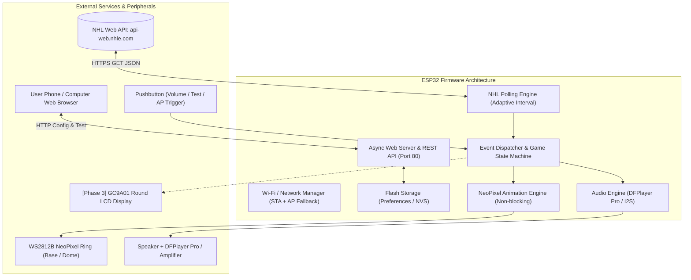

# Rob's NHL Goal Light 🚨

A customizable, 3D-printed caged hockey goal light powered by an ESP32 microcontroller. The device monitors real-time NHL games using public NHL APIs, lights up with custom animations for goals and in-game events, plays authentic team horns/sounds, and hosts an onboard web portal for configuration.

---

## 📋 Table of Contents
- [Project Overview](#project-overview)
- [Key Features](#key-features)
- [Project Structure & Documentation](#project-structure--documentation)
- [System Architecture High-Level](#system-architecture-high-level)
- [Hardware Overview](#hardware-overview)
- [Quick Start & Setup](#quick-start--setup)
- [Future Roadmap (Display & Smart Home)](#future-roadmap-display--smart-home)

---

## 🏒 Project Overview

Traditional novelty goal lights rely on proprietary companion apps, paid subscriptions, or fragile cloud relays that break when servers shut down. 

This project is a standalone, self-contained IoT device that communicates directly with the NHL Web API (`https://api-web.nhle.com/v1`). It combines:
1. **Physical Design**: 3D-printed base housing the electronics, topped with a red dome enclosed in a safety cage.
2. **Dynamic Lighting**: NeoPixel / WS2812B addressable LEDs providing police-strobe, beacon-rotation, and pulse effects in custom team colors.
3. **Sound**: Integrated audio (DFPlayer Pro / I2S) for playing team-specific goal horns and goal songs.
4. **Autonomous Game Polling**: Intelligent polling engine inspired by [hockeygamebot](file:///Users/robtesta/Documents/Arduino/NHL%20Goal%20Light%2010.2026/hockeygamebot) with adaptive intervals (pregame ramp-up, 4-second live polling, intermission cooldown).
5. **Embedded Web Configuration Portal**: Responsive mobile-friendly web page hosted on the ESP32 via mDNS (`http://goallight.local`) for setting favorite teams, brightness, volume, audio tracks, and Wi-Fi credentials.

---

## ✨ Key Features

- **Direct NHL API Integration**: No intermediary server required. Direct HTTPS fetching from NHL Edge / GameCenter endpoints.
- **Smart Game State Tracking**: Detects when your team plays today, counts down to puck drop, tracks live score changes, and avoids false triggers on score reversals or shootout attempts.
- **Multi-Event Alerting**:
  - 🚨 **Team Goal**: High-intensity beacon rotation + authentic goal horn.
  - 🥅 **Opponent Goal**: Subtle pulse or warning flash (optional/configurable).
  - ⚡ **Power Play / Penalty**: Yellow strobe or team color sweep when the opponent is penalized.
  - 🏒 **Period Start / End**: Intermission reminder lighting.
  - 🏆 **Game Win**: Extended celebration fanfare when the game goes FINAL and your team wins.
- **Local Web Server**:
  - Connects to home Wi-Fi or spins up an Access Point (`NHL-Goal-Light-Setup`) if Wi-Fi drops.
  - Select any of the 32 NHL teams with auto-populated team colors and abbreviations.
  - Test buttons for LEDs and goal horns directly from your phone.
  - Volume, animation speed, and brightness sliders saved to persistent non-volatile flash storage (`Preferences` / NVS).
- **Extensible Firmware**: Modular C++ / Arduino structure designed to easily incorporate an SPI round LCD display (GC9A01 240x240) in Phase 3.

---

## 📚 Project Structure & Documentation

All project documentation and code are maintained in this directory:

| Document | Purpose |
| :--- | :--- |
| [ARCHITECTURE.md](file:///Users/robtesta/Documents/Arduino/NHL%20Goal%20Light%2010.2026/Rob%20NHL%20Goal%20Light/ARCHITECTURE.md) | Software architecture, FreeRTOS tasks, state machine, and data flow |
| [HARDWARE_SPECS.md](file:///Users/robtesta/Documents/Arduino/NHL%20Goal%20Light%2010.2026/Rob%20NHL%20Goal%20Light/HARDWARE_SPECS.md) | Bill of Materials (BOM), pinouts, power distribution, and 3D enclosure notes |
| [NHL_API_GUIDE.md](file:///Users/robtesta/Documents/Arduino/NHL%20Goal%20Light%2010.2026/Rob%20NHL%20Goal%20Light/NHL_API_GUIDE.md) | NHL API endpoints, streaming JSON parsing strategy, and memory optimization |
| [EVENT_MATRIX.md](file:///Users/robtesta/Documents/Arduino/NHL%20Goal%20Light%2010.2026/Rob%20NHL%20Goal%20Light/EVENT_MATRIX.md) | Specification of in-game events, visual light patterns, and audio cues |
| [WEB_INTERFACE_SPEC.md](file:///Users/robtesta/Documents/Arduino/NHL%20Goal%20Light%2010.2026/Rob%20NHL%20Goal%20Light/WEB_INTERFACE_SPEC.md) | Web server architecture, REST endpoints, HTML/CSS UI design, and team assets |
| [REMOTE_ASSETS_SYNC.md](file:///Users/robtesta/Documents/Arduino/NHL%20Goal%20Light%2010.2026/Rob%20NHL%20Goal%20Light/REMOTE_ASSETS_SYNC.md) | Remote GitHub asset repo, dynamic team horn/graphic downloads, and flash caching |
| [STORAGE_EXPANSION_GUIDE.md](file:///Users/robtesta/Documents/Arduino/NHL%20Goal%20Light%2010.2026/Rob%20NHL%20Goal%20Light/STORAGE_EXPANSION_GUIDE.md) | MicroSD card expansion and 16MB flash options for unlimited team horns |
| [WEB_FLASHER_GUIDE.md](file:///Users/robtesta/Documents/Arduino/NHL%20Goal%20Light%2010.2026/Rob%20NHL%20Goal%20Light/WEB_FLASHER_GUIDE.md) | 1-click no-code browser web flasher using ESP Web Tools on GitHub Pages |
| [ROADMAP.md](file:///Users/robtesta/Documents/Arduino/NHL%20Goal%20Light%2010.2026/Rob%20NHL%20Goal%20Light/ROADMAP.md) | Phased implementation plan, including future round LCD display integration |

---

## ⚙️ System Architecture High-Level

---

## 🛠️ Hardware Overview

- **Microcontroller**: ESP32 (e.g. Seeed Studio XIAO ESP32-C3 / S3, or ESP32-WROOM / ESP32-S3 DevKit).
- **Lighting**: 16x or 24x WS2812B 5050 RGB NeoPixel ring (or dual rings for base rotation + top strobe).
- **Audio Module**: DFRobot DFPlayer Pro (DF1201S) onboard 128MB flash / USB-C, or MAX98357A I2S DAC amp with SD card / SPIFFS.
- **Controls**: Tactile momentary pushbutton with debouncing (Short press = Volume / Mode, Long press = Test Horn, Hold on boot = Force AP mode).
- **Power**: 5V USB-C power supply (min 2A recommended to handle simultaneous Wi-Fi TX, NeoPixel peak brightness, and audio amplifier).

---

## 🚀 Quick Start & Setup

1. **Firmware Build**: Using VS Code + PlatformIO or Arduino IDE 2.x with ESP32 board support.
2. **First Boot**: If Wi-Fi is unconfigured or unavailable, the device creates an access point named `NHL-Goal-Light-Setup`. Connect to it, browse to `http://192.168.4.1`, and enter your Wi-Fi credentials.
3. **Normal Operation**: Browse to `http://goallight.local` on your local network to choose your primary team (e.g. `NYR`, `BOS`, `VGK`, `TOR`, `COL`), set horn volume, and customize lighting patterns.
