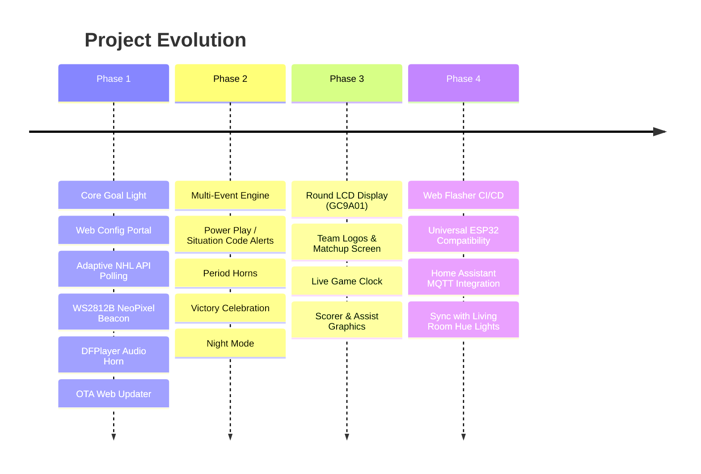
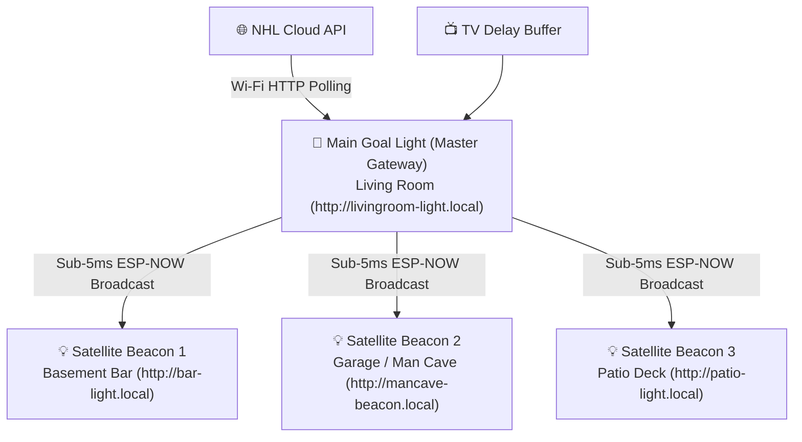

# Project Roadmap & Future Enhancements

This document outlines the phased development roadmap for **NHL Goal Light**, detailing immediate milestones, the planned round display integration, and smart home connectivity.

---

## 🗺️ Roadmap Overview

---

## 📍 Phase 1: Core Goal Light & Web Portal (Current Milestone)

- [x] Architectural design, hardware specifications, and API documentation.
- [x] ESP32 core firmware setup (Arduino IDE / PlatformIO compatible).
- [x] Wi-Fi Manager with captive portal fallback (`NHL-Goal-Light-Setup` AP mode on `192.168.4.1`).
- [x] Embedded responsive dark-mode web portal (`http://goallight.local`):
  - 32-team selector with automated team colours.
  - Brightness, celebration effect style (Rotating Halogen Beacon, Arena Strobe, Team Colour Breathe, Dual Siren Flasher, Heartbeat Pulse), and duration controls.
  - Sound controls with test buttons.
  - Custom SVG Goal Light tab icon (favicon).
  - **Over-The-Air (OTA) Web Firmware Updater (`/api/update`)** with real-time percentage progress bar.
  - **Live GitHub Release Checker**: Queries `api.github.com` directly from the browser to check for new updates with release notes.
- [x] Adaptive NHL API polling client (`/club-schedule` & `/boxscore`).
- [x] Non-blocking WS2812B animation engine.
- [x] Hardware Serial DFPlayer Pro (DF1201S) driver with fallback to silent/light-only testing.
- [x] Physical button debouncer (Single press = Volume cycle, Double press = Test goal horn, Long press = Force AP mode).

---

## 📍 Phase 2: Enhanced Game Intelligence & Multi-Event Audio

- [ ] **TV Broadcast Delay & Goal Horn Synchronisation Engine**:
  - Eliminate broadcast spoiler issues where the NHL API detects a goal 15–45 seconds before cable or streaming feeds (e.g. Sportsnet+, TSN, ESPN+, Apple TV, Prime).
  - Configurable broadcast delay buffer (0 to 120 seconds).
  - **Interactive Live Game Clock Synchroniser**: Web portal displays live NHL game clock side-by-side with a "Sync with TV" tool so users can match their television screen to the exact second.
  - **1-Tap Auto-Calibrator ("Puck Just Crossed the Line")**: User taps a button the moment a goal airs on their TV, automatically calculating the streaming latency delta for the remainder of the game.
  - **Broadcaster Presets**: Quick delay profiles for Over-The-Air antenna (0s), Cable/Satellite (12s), and streaming apps (30–50s).
  - **Discrete "Goal Pending" Cue**: Optional subtle amber LED cue notifying the user that a celebration is queued in the buffer before the horn erupts on TV.
- [ ] **Pre-Game Notification Prompt & Custom Game Profiles**:
  - Automatically detect upcoming games from the NHL API schedule.
  - User-configurable pre-game notification alert (e.g. 15, 30, or 60 minutes prior to puck drop).
  - Interactive prompt (via Web Push PWA notification, Home Assistant actionable alert, or physical beacon chime):
    - Inquires whether the user wishes to activate the Goal Light for tonight's game.
    - Allows immediate selection of game session profiles: *Family Friendly* (moderate volume, no loud buzzers), *Party / Game 7* (maximum brightness, full arena strobes & victory fanfare), or *Late Night / Quiet* (subtle colour breathing, muted audio).
- [ ] **Remote GitHub Asset Sync Engine**: Connects to GitHub asset repository to dynamically download team-specific goal horns (`.mp3`) and 240×240 circular logos (`.bin`) into `LittleFS` on team change. See [REMOTE_ASSETS_SYNC.md](file:///Users/robtesta/Documents/Arduino/NHL%20Goal%20Light%2010.2026/NHL%20Goal%20Light/REMOTE_ASSETS_SYNC.md).
- [ ] **Power Play Detection**: Parse NHL API 4-digit `situationCode` (e.g. `1451`) to trigger amber power-play strobes.
- [ ] **Period Horns & Intermission Mode**: Distinct audio buzzers on period start/end; calm cyan breathing effect during intermissions.
- [ ] **Victory Fanfare**: Detect `FINAL`/`OFF` state; if preferred team won, trigger an extended 30-second light celebration with arena victory music.
- [ ] **Disallowed Goal Protection**: Handle score rollbacks silently if a goal is overturned upon video review.
- [ ] **Do Not Disturb / Night Mode**: Automated scheduled dimming or silent mode for late West Coast games.
- [ ] **Multi-Team Support**: Option to track a secondary team with distinct colour alerts.

---

## 📍 Phase 3: Round LCD Display Integration (User Feature Request) 📺

Integration of a circular IPS LCD flush-mounted on the front face of the 3D-printed base (like a stadium scoreboard).

### Hardware Candidates
1. **Waveshare 1.28-inch Round LCD (GC9A01)**:
   - Resolution: 240×240 pixels, 65K RGB colours.
   - Interface: 4-wire SPI + DMA.
   - Form factor: Compact circular module flush-mounted on the base front face.
2. **All-In-One ESP32-S3 Round Display Modules** (e.g. Waveshare ESP32-S3-Touch-LCD-1.28).

### Graphics Architecture
- **Framework**: LVGL 9 (Light and Versatile Graphics Library) or `TFT_eSPI` with SPI DMA rendering.
- **Dynamic Assets**: Stream 16-bit RGB565 raw team logos (`logo_240.bin`) directly from `LittleFS` into the display buffer.

### Planned Display Screens:

| Screen Mode | Visual Contents | Trigger Condition |
| :--- | :--- | :--- |
| **Idle / Off-Day** | Team Logo + Digital Clock + Next Game Countdown ("vs BOS - Tomorrow 7:00 PM") | No game currently active |
| **Pregame Warmup** | Matchup card (Away Logo vs Home Logo), Arena name, Puck drop timer | Within 60 min of start |
| **Live In-Game** | Live scoreboard: Team logos, current score (`NYR 3 - 1 BOS`), period indicator (`P2`), and game clock countdown (`08:42`) | Game `LIVE` |
| **Goal Celebration!** | Flashing "🚨 GOAL! 🚨" banner with animated spinning puck, followed by player headshot, name, and season goal count | Preferred team scores |
| **Power Play** | Glowing "POWER PLAY" banner with 2:00 countdown clock | Man advantage awarded |
| **Intermission** | Intermission countdown timer + Shots On Goal (SOG) comparison | Between periods |
| **Final / Win** | "FINAL - RANGERS WIN!" celebratory screen with animated stars | Game ends in victory |

---

## 📍 Phase 4: Web Flasher CI/CD & Universal Multi-Device Ecosystem

- [ ] **Automated GitHub Actions Firmware Builds for Web Flasher**:
  - Automatically compiles `.bin` assets on every release: `bootloader.bin`, `partitions.bin`, `firmware.bin`, and merged single-file binary.
  - Automatically commits or deploys binaries to GitHub Pages (`docs/builds/`) so users can flash in 1-click via the Web Serial Flasher in Chrome/Edge.
- [ ] **Universal Multi-ESP32 Device Compatibility Layer**:
  - Pre-mapped pin profiles and build configurations for:
    - **ESP32-S3 Super Mini** (ultra-compact base builds)
    - **Seeed Studio XIAO ESP32-S3 / C3**
    - **Standard ESP32-WROOM-32 DevKit** (30-pin & 38-pin)
    - **ESP32-S2 / ESP32-C6**
  - Pin-mapping header abstraction with compile-time or web-configurable pin assignment.
- [ ] **Home Assistant Integration**:
  - Auto-discovery via MQTT (`homeassistant/light/goal_light/config`).
  - Native Home Assistant entities:
    - `light.goal_light`: Power, brightness, colour, and effect controls.
    - `sensor.nhl_game_state`: Current score, period, clock, and opponent.
    - `button.test_goal_horn`: Trigger physical horn remotely.
    - `select.preferred_team`: Change team from Home Assistant dashboards.
- [ ] **Whole-House Goal Sync**: Broadcast MQTT or webhook events so room lights (Philips Hue, LIFX, WLED) flash red in sync with the goal light.

---

## 📍 Multi-Device Ecosystem: ESP-NOW Wireless Mesh & Satellite Goal Light Synchronisation 📡

A peer-to-peer low-latency wireless synchronisation system allowing multiple Goal Lights to celebrate in absolute lockstep across different rooms, floors, or outdoor patios without saturating home Wi-Fi bandwidth.

### Architecture Overview

### Core Features

1. **Master Gateway & Satellite Topology**:
   - **Main Device (Master)**: Handles internet connectivity, queries NHL API live endpoints, runs the TV Broadcast Delay buffer, and broadcasts high-speed ESP-NOW celebration packets the instant a goal is validated.
   - **Satellite Units**: Compact, standalone receiver units with their own WS2812B LEDs and DFPlayer audio. They listen on the local radio channel and fire their beacons and horns in lockstep with the Master (< 5ms latency).
2. **Dynamic Unique `*.local` mDNS Network Addressing**:
   - Each light derives its local network address dynamically from its custom friendly name (e.g. `"Living Room"` -> `http://living-room.local`, `"Man Cave"` -> `http://man-cave.local`).
   - Default hardware MAC suffix hashing (e.g. `http://goallight-3a4f.local`) ensures zero mDNS hostname collisions when multiple unconfigured units are powered on the same home network simultaneously.
3. **Zero-Configuration Auto-Pairing Protocol**:
   - Satellites discover the Master's operating Wi-Fi channel automatically.
   - Pairing can be completed with a 1-tap button in the web portal or via physical button press sequence.
4. **Independent Satellite Profiles**:
---

## 📍 Phase 5: Native Companion Apps (iOS & Android Roadmap) 📱

While the installable Progressive Web App (PWA) provides zero-install native-like controls today, dedicated native iOS and Android applications are planned on the long-term roadmap to unlock mobile-specific platform capabilities:

1. **Bluetooth Low Energy (BLE) & mDNS Auto-Discovery**:
   - Instant discovery of nearby Goal Lights on the local network or via BLE without entering IP addresses.
   - 1-tap onboarding wizard to connect new goal lights to home Wi-Fi directly from Bluetooth.
2. **Live Activities & Dynamic Island Integration (iOS)**:
   - Real-time score clock and penalty timers displayed on the iPhone Lock Screen and Dynamic Island during live games.
3. **Interactive Home Screen Widgets**:
   - Quick at-a-glance scoreboard widgets (Next Game, Live Score, Period Clock).
   - Interactive widget buttons to trigger physical light celebrations or mute volume directly from the home screen.
4. **Local Network Background Push Alerts**:
   - Background audio and haptic feedback when your team scores, even when your phone screen is turned off.

---

## 🌐 Community Charter, Open Source Philosophy & MakerWorld 3D Models

### 1. 100% Free & Open Source (MIT Licensed)
This project is built by a passionate hockey fan for hockey fans everywhere. All source code, schematics, board configurations, and documentation are provided completely free under the permissive MIT Open Source License. There are no subscriptions, no locked tiers, and no advertisements.

### 2. MakerWorld 3D Printable Enclosure Models
Custom 3D printable files are being designed and hosted for free community download (via MakerWorld / Printables):
- Base enclosure with mount points for ESP32-S3 Super Mini, DFPlayer Mini, and 3W speaker.
- Diffuser ring for 16-LED NeoPixel ring.
- Translucent halogen-style red beacon dome lens.
- Snap-fit assembly with optional heat-set threaded inserts.

### 3. Voluntary Community Support & Donations
Because this project is maintained as a labour of love in spare time without corporate backing, keeping it completely open source allows the community to contribute bug fixes, suggest new features, and build their own hardware variations freely. For community members who wish to support ongoing development, voluntary donation links (Ko-fi / GitHub Sponsors) are available to help fund prototype components, test hardware, and coffee.

### 4. Proudly Vibe Coded & Transparent
In alignment with modern software development practices, this project is proudly **vibe coded** — designed and implemented collaboratively with state-of-the-art AI coding assistants alongside rigorous human physical hardware testing and validation. The entire codebase is completely public, thoroughly commented, and open for community peer review, security auditing, and collaborative pull requests.

