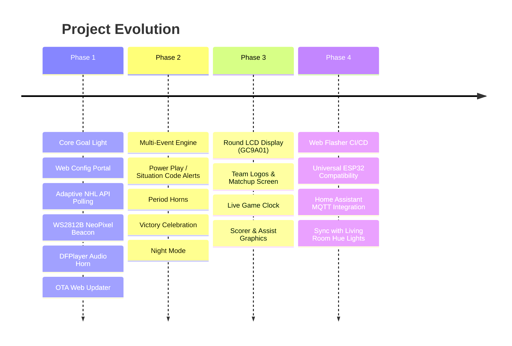

# Project Roadmap & Future Enhancements

This document outlines the phased development roadmap for **NHL Goal Light**, detailing immediate milestones, the planned round display integration, and smart home connectivity.

---

## 🗺️ Roadmap Overview

---

## 📍 Phase 1: Core Goal Light & Web Portal (Current Milestone)

- [x] Architectural design, hardware specifications, and API documentation.
- [x] ESP32 core firmware setup (Arduino IDE / PlatformIO compatible).
- [x] Wi-Fi Manager with captive portal fallback (`NHL-Goal-Light-Setup` AP mode on `192.168.4.1`).
- [x] Embedded responsive dark-mode web portal (`http://goallight.local`):
  - 32-team selector with automated team colors.
  - Brightness, effect style (Beacon, Arena Strobe, Team Breath), and duration controls.
  - Sound controls with test buttons.
  - Custom SVG Goal Light tab icon (favicon).
  - **Over-The-Air (OTA) Web Firmware Updater (`/api/update`)** with real-time percentage progress bar.
  - **Live GitHub Release Checker**: Queries `api.github.com` directly from the browser to check for new updates with release notes.
- [x] Adaptive NHL API polling client (`/club-schedule` & `/boxscore`).
- [x] Non-blocking WS2812B animation engine.
- [x] Hardware Serial DFPlayer Pro (DF1201S) driver with fallback to silent/light-only testing.
- [x] Physical button debouncer (Single press = Volume cycle, Double press = Test goal horn, Long press = Force AP mode).

---

## 📍 Phase 2: Enhanced Game Intelligence & Multi-Event Audio

- [ ] **Remote GitHub Asset Sync Engine**: Connects to GitHub asset repository to dynamically download team-specific goal horns (`.mp3`) and 240×240 circular logos (`.bin`) into `LittleFS` on team change. See [REMOTE_ASSETS_SYNC.md](file:///Users/robtesta/Documents/Arduino/NHL%20Goal%20Light%2010.2026/NHL%20Goal%20Light/REMOTE_ASSETS_SYNC.md).
- [ ] **Power Play Detection**: Parse NHL API 4-digit `situationCode` (e.g. `1451`) to trigger amber power-play strobes.
- [ ] **Period Horns & Intermission Mode**: Distinct audio buzzers on period start/end; calm cyan breathing effect during intermissions.
- [ ] **Victory Fanfare**: Detect `FINAL`/`OFF` state; if preferred team won, trigger an extended 30-second light celebration with arena victory music.
- [ ] **Disallowed Goal Protection**: Handle score rollbacks silently if a goal is overturned upon video review.
- [ ] **Do Not Disturb / Night Mode**: Automated scheduled dimming or silent mode for late West Coast games.
- [ ] **Multi-Team Support**: Option to track a secondary team with distinct color alerts.

---

## 📍 Phase 3: Round LCD Display Integration (User Feature Request) 📺

Integration of a circular IPS LCD flush-mounted on the front face of the 3D-printed base (like a stadium scoreboard).

### Hardware Candidates
1. **Waveshare 1.28-inch Round LCD (GC9A01)**:
   - Resolution: 240×240 pixels, 65K RGB colors.
   - Interface: 4-wire SPI + DMA.
   - Form factor: Compact circular module flush-mounted on the base front face.
2. **All-In-One ESP32-S3 Round Display Modules** (e.g. Waveshare ESP32-S3-Touch-LCD-1.28).

### Graphics Architecture
- **Framework**: LVGL 9 (Light and Versatile Graphics Library) or `TFT_eSPI` with SPI DMA rendering.
- **Dynamic Assets**: Stream 16-bit RGB565 raw team logos (`logo_240.bin`) directly from `LittleFS` into the display buffer.

### Planned Display Screens:

| Screen Mode | Visual Contents | Trigger Condition |
| :--- | :--- | :--- |
| **Idle / Off-Day** | Team Logo + Digital Clock + Next Game Countdown ("vs BOS - Tomorrow 7:00 PM") | No game currently active |
| **Pregame Warmup** | Matchup card (Away Logo vs Home Logo), Arena name, Puck drop timer | Within 60 min of start |
| **Live In-Game** | Live scoreboard: Team logos, current score (`NYR 3 - 1 BOS`), period indicator (`P2`), and game clock countdown (`08:42`) | Game `LIVE` |
| **Goal Celebration!** | Flashing "🚨 GOAL! 🚨" banner with animated spinning puck, followed by player headshot, name, and season goal count | Preferred team scores |
| **Power Play** | Glowing "POWER PLAY" banner with 2:00 countdown clock | Man advantage awarded |
| **Intermission** | Intermission countdown timer + Shots On Goal (SOG) comparison | Between periods |
| **Final / Win** | "FINAL - RANGERS WIN!" celebratory screen with animated stars | Game ends in victory |

---

## 📍 Phase 4: Web Flasher CI/CD & Universal Multi-Device Ecosystem

- [ ] **Automated GitHub Actions Firmware Builds for Web Flasher**:
  - Automatically compiles `.bin` assets on every release: `bootloader.bin`, `partitions.bin`, `firmware.bin`, and merged single-file binary.
  - Automatically commits or deploys binaries to GitHub Pages (`docs/builds/`) so users can flash in 1-click via the Web Serial Flasher in Chrome/Edge.
- [ ] **Universal Multi-ESP32 Device Compatibility Layer**:
  - Pre-mapped pin profiles and build configurations for:
    - **ESP32-S3 Super Mini** (ultra-compact base builds)
    - **Seeed Studio XIAO ESP32-S3 / C3**
    - **Standard ESP32-WROOM-32 DevKit** (30-pin & 38-pin)
    - **ESP32-S2 / ESP32-C6**
  - Pin-mapping header abstraction with compile-time or web-configurable pin assignment.
- [ ] **Home Assistant Integration**:
  - Auto-discovery via MQTT (`homeassistant/light/goal_light/config`).
  - Native Home Assistant entities:
    - `light.goal_light`: Power, brightness, color, and effect controls.
    - `sensor.nhl_game_state`: Current score, period, clock, and opponent.
    - `button.test_goal_horn`: Trigger physical horn remotely.
    - `select.preferred_team`: Change team from Home Assistant dashboards.
- [ ] **Whole-House Goal Sync**: Broadcast MQTT or webhook events so room lights (Philips Hue, LIFX, WLED) flash red in sync with the goal light.
