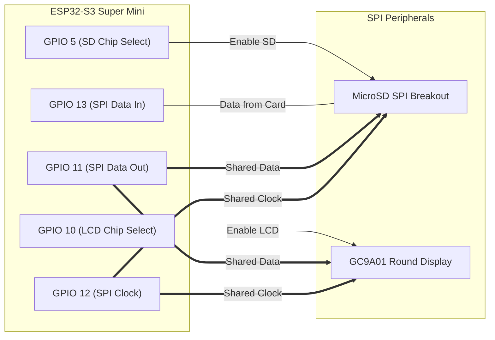

# Storage Expansion Guide: MicroSD & High-Capacity Flash

This guide explores the best ways to expand storage on **Rob's NHL Goal Light** to support all 32 NHL team horns, goal songs, sirens, victory fanfares, and full-color round display graphics without memory limitations.

---

## 1. Storage Comparison Overview

| Method | Usable Capacity | Remote Wi-Fi Downloads? | Extra Hardware Needed | Cost | Recommended For |
| :--- | :--- | :--- | :--- | :--- | :--- |
| **MicroSD Card Module (SPI)** *(Best Overall)* | **4 GB – 32 GB** (Virtually unlimited) | **Yes** (ESP32 writes directly to SD over Wi-Fi) | MicroSD SPI module + MicroSD card | **~$0.50** (module) + card | All 32 teams, multiple horns per team, full arena songs, graphics |
| **ESP32-S3 16MB Flash (LittleFS)** | **10 MB – 12 MB** | **Yes** (OTA downloads to flash) | None (if board has 16MB flash) | $0 | ~60–80 short horn clips (150KB each) |
| **DFPlayer Pro Onboard Flash** | **128 MB** | **No** (Must plug USB-C to PC to load files) | DFPlayer Pro board | ~$12.00 | Preloading files once from a PC |
| **Live Wi-Fi HTTP Streaming** | Infinite (Streams directly from web) | Plays live from web | None (requires fast Wi-Fi) | $0 | Real-time web audio |

---

## 2. Option 1: MicroSD Card Module (Recommended for Unlimited Storage)

Adding a miniature SPI MicroSD card module gives you **gigabytes of storage**, allowing you to hold every NHL team horn, alternate goal songs, player soundbites, and hundreds of 240×240 display graphics.

### How Remote Downloading Works with MicroSD:
Unlike basic MP3 boards where you must pull the SD card out and put it into a computer, the **ESP32-S3 has full native read/write access to the SD card**:
1. When you select a team or click "Update Assets" in the web portal, the ESP32 downloads the MP3 or graphic from GitHub.
2. The ESP32 writes the stream directly to the SD card:
   ```cpp
   File file = SD.open("/teams/NYR/goal_horn.mp3", FILE_WRITE);
   file.write(httpStreamBuffer, bytesRead);
   file.close();
   ```
3. Audio plays directly from `/sd/` through the **MAX98357A I2S amplifier**.

### MicroSD Hardware on AliExpress:
* **MicroSD TF Card Module (SPI)**: Measures only ~15 mm × 15 mm. Search: `"Micro SD card SPI module mini"`.
* **Cost**: **~$0.40 – $0.60**.
* **Card Format**: Any standard MicroSD or MicroSDHC card (4GB, 8GB, 16GB, or 32GB) formatted as **FAT32**.

---

## 3. Pin Sharing & Bus Allocation on ESP32-S3 Super Mini

You do **not** run out of pins when adding a MicroSD card because it shares the high-speed **SPI bus** with the future GC9A01 round display!



### Complete Pin Budget (All Peripherals Included):

| Peripheral | Super Mini Pin | GPIO | Function |
| :--- | :--- | :--- | :--- |
| **WS2812B NeoPixel Ring** | `4` | `GPIO 4` | Addressable LED Data Line |
| **Tactile Pushbutton** | `9` | `GPIO 9` | Button to GND (`INPUT_PULLUP`) |
| **MAX98357A I2S BCLK** | `1` | `GPIO 1` | Audio Bit Clock |
| **MAX98357A I2S LRC** | `2` | `GPIO 2` | Audio Word Select |
| **MAX98357A I2S DIN** | `8` | `GPIO 8` | Audio Serial Data |
| **Shared SPI Clock (SCK)** | `12` | `GPIO 12` | Clock for **both** SD Card & LCD |
| **Shared SPI MOSI (SDA)** | `11` | `GPIO 11` | Data Out for **both** SD Card & LCD |
| **MicroSD SPI MISO** | `13` | `GPIO 13` | Data In from SD Card |
| **MicroSD Chip Select (CS)**| `5` | `GPIO 5` | Active-low SD card selector |
| **[Phase 3] Round LCD CS** | `10` | `GPIO 10` | Active-low LCD selector |
| **[Phase 3] Round LCD DC** | `7` | `GPIO 7` | Data/Command selector |
| **[Phase 3] Round LCD RST** | `6` | `GPIO 6` | Display hardware reset |
| **[Phase 3] Round LCD BLK** | `3` | `GPIO 3` | Backlight PWM dimmer |

> [!NOTE]
> That uses **13 out of the 14 available GPIO pins** on the ESP32-S3 Super Mini. Everything fits on this tiny board without needing multiplexers or port expanders!

---

## 4. Option 2: 16MB Onboard Flash Partitioning

If you purchase or already have an **ESP32-S3 Super Mini with 16MB Flash** (very common on AliExpress for ~$3.50):
- You can partition the internal flash to allocate **10 MB to 12 MB for `LittleFS`**.
- At 128 kbps, 1 second of MP3 audio $\approx$ 16 KB.
- A 12-second goal horn is only ~192 KB.
- **10 MB of LittleFS holds ~50 distinct goal horns and sounds** directly on the chip with zero external hardware.

### 16MB Partition Table (`partitions_16MB.csv`):
```csv
# Name,   Type, SubType, Offset,   Size,     Flags
nvs,      data, nvs,     0x9000,   0x5000,
otadata,  data, ota,     0xe000,   0x2000,
app0,     app,  ota_0,   0x10000,  0x200000, # 2MB Firmware
app1,     app,  ota_1,   0x210000, 0x200000, # 2MB OTA Update
spiffs,   data, spiffs,  0x410000, 0xBC0000, # 11.75 MB LittleFS Storage!
```

---

## 5. Summary & Recommendation

1. **For Bench Testing Today**:
   - You don't need any storage expansion or audio hardware yet. Test your ESP32-S3 Super Mini and NeoPixel light ring right now using [Rob_NHL_Goal_Light.ino](file:///Users/robtesta/Documents/Arduino/NHL%20Goal%20Light%2010.2026/Rob%20NHL%20Goal%20Light/Rob_NHL_Goal_Light.ino).
2. **For Ultimate Audio & Custom Horns**:
   - Pair the **MAX98357A I2S Amplifier (~$0.90)** with a **MicroSD SPI Module (~$0.50)**.
   - This provides virtually infinite gigabytes of space for all 32 teams and custom horns, supports direct over-the-air file downloads from GitHub, and costs under $2.00 total for both boards!
