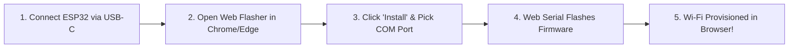

# Zero-Code Web Flasher & Firmware Installation Guide

This guide details how to set up a 1-click, browser-based web flasher using **ESP Web Tools** (hosted on GitHub Pages), allowing anyone to flash the **Rob NHL Goal Light** firmware without installing Arduino IDE, PlatformIO, Python, or USB drivers.

---

## 1. How It Works (The User Experience)



1. **Plug In**: The user connects the **ESP32-S3 Super Mini** to their PC/Mac using a standard USB-C data cable.
2. **Visit Site**: The user opens your project's GitHub Pages site in Google Chrome, Microsoft Edge, Brave, or Opera.
3. **1-Click Install**: The user clicks the **"Install NHL Goal Light"** button.
4. **Browser Popup**: The browser displays a Web Serial prompt asking to select the serial port (e.g., `USB JTAG/serial debug unit` or `CP2102`).
5. **Auto-Flash**: The site erases flash, writes the bootloader, partitions, and firmware binary with a live progress bar.
6. **Wi-Fi Provisioning**: Once flashed, ESP Web Tools automatically opens a dialog allowing the user to enter their home Wi-Fi SSID and password directly over USB serial!

---

## 2. Web Flasher Architecture (ESP Web Tools)

**ESP Web Tools** is an open-source standard created by the Home Assistant / ESPHome team, powering flashers for WLED, Tasmota, and OpenHASP.

It consists of:
1. An HTML page embedding the custom Web Component `<esp-web-install-button>`.
2. A manifest JSON file describing the target chip (`ESP32-S3`) and binary offsets.
3. Compiled binary files (`firmware.bin`, `bootloader.bin`, `partitions.bin`).

---

## 3. GitHub Pages Repository Setup

Create a `docs/` folder in your repository (or a `gh-pages` branch) with the following files:

```text
nhl-goal-light/
└── docs/
    ├── index.html            <-- The Web Flasher landing page
    ├── manifest.json         <-- Firmware offsets and chip specs
    └── builds/
        ├── bootloader.bin    <-- ESP32-S3 ROM bootloader (offset 0x0000)
        ├── partitions.bin    <-- Partition table (offset 0x8000)
        ├── boot_app0.bin     <-- OTA boot selection (offset 0xe000)
        └── firmware.bin      <-- Compiled Goal Light sketch (offset 0x10000)
```

---

## 4. Web Flasher Manifest (`manifest.json`)

```json
{
  "name": "Rob's NHL Goal Light",
  "version": "1.0.0",
  "home_assistant_domain": "esphome",
  "new_install_prompt_erase": true,
  "builds": [
    {
      "chipFamily": "ESP32-S3",
      "parts": [
        { "path": "builds/bootloader.bin", "offset": 0 },
        { "path": "builds/partitions.bin", "offset": 32768 },
        { "path": "builds/boot_app0.bin", "offset": 57344 },
        { "path": "builds/firmware.bin", "offset": 65536 }
      ]
    }
  ]
}
```

> [!NOTE]
> Alternatively, you can merge all four binaries into a single `merged-firmware.bin` flashed at offset `0x0000` using `esptool.py merge_bin`.

---

## 5. Web Flasher Landing Page (`index.html`)

Here is the complete, responsive landing page ready to host on GitHub Pages:

```html
<!DOCTYPE html>
<html lang="en">
<head>
  <meta charset="UTF-8">
  <meta name="viewport" content="width=device-width, initial-scale=1.0">
  <title>Flash Rob's NHL Goal Light</title>
  <script type="module" src="https://unpkg.com/esp-web-tools@10/dist/web/install-button.js?module"></script>
  <style>
    :root {
      --bg: #0d1117;
      --card: #161b22;
      --border: #30363d;
      --accent: #e63946;
      --text: #f0f6fc;
      --muted: #8b949e;
    }
    body {
      font-family: -apple-system, BlinkMacSystemFont, "Segoe UI", Roboto, sans-serif;
      background: var(--bg);
      color: var(--text);
      display: flex;
      flex-direction: column;
      align-items: center;
      justify-content: center;
      min-height: 100vh;
      margin: 0;
      padding: 20px;
      text-align: center;
    }
    .card {
      background: var(--card);
      border: 1px solid var(--border);
      border-radius: 16px;
      padding: 32px 24px;
      max-width: 460px;
      width: 100%;
      box-shadow: 0 12px 32px rgba(0,0,0,0.5);
    }
    h1 {
      margin-top: 0;
      font-size: 1.8rem;
      letter-spacing: -0.5px;
    }
    p {
      color: var(--muted);
      line-height: 1.5;
      font-size: 0.95rem;
    }
    .instructions {
      text-align: left;
      background: rgba(255,255,255,0.03);
      border-radius: 8px;
      padding: 16px;
      margin: 20px 0;
      font-size: 0.85rem;
    }
    .instructions ol { margin-left: 20px; }
    .instructions li { margin-bottom: 8px; }
    esp-web-install-button {
      display: inline-block;
      margin-top: 10px;
    }
  </style>
</head>
<body>
  <div class="card">
    <h1>🚨 NHL Goal Light Flasher</h1>
    <p>Install or update firmware directly onto your ESP32-S3 from your web browser.</p>

    <div class="instructions">
      <ol>
        <li>Connect your <strong>ESP32-S3 Super Mini</strong> via USB-C cable.</li>
        <li>Ensure you are using <strong>Google Chrome</strong> or <strong>Microsoft Edge</strong>.</li>
        <li>Click <strong>Install</strong> below and pick your ESP32 port.</li>
        <li>Keep the cable connected until the progress reaches 100%.</li>
      </ol>
    </div>

    <!-- ESP Web Tools Install Button Component -->
    <esp-web-install-button manifest="./manifest.json">
      <button slot="activate" style="padding: 14px 28px; font-size: 1rem; font-weight: bold; background: #e63946; color: white; border: none; border-radius: 8px; cursor: pointer;">
        🚀 Install Firmware
      </button>
      <span slot="unsupported">
        ⚠️ Web Serial is not supported in this browser. Please open this page in Chrome or Edge on a PC/Mac.
      </span>
      <span slot="not-allowed">
        ⚠️ Web Serial requires HTTPS or localhost.
      </span>
    </esp-web-install-button>
  </div>
</body>
</html>
```

---

## 6. Exporting Firmware Binaries

### Option A: Using PlatformIO CLI
Run the following command from the project root:
```bash
pio run -e esp32s3_super_mini
```
The compiled binaries are generated in `.pio/build/esp32s3_super_mini/`:
- `firmware.bin`
- `bootloader.bin`
- `partitions.bin`

### Option B: Merging into a Single Binary
To create a single unified binary that can be flashed at offset `0x0`:
```bash
python -m esptool --chip esp32s3 merge_bin \
  -o docs/builds/merged_firmware.bin \
  --flash_mode dio \
  --flash_freq 80m \
  --flash_size 4MB \
  0x0000 .pio/build/esp32s3_super_mini/bootloader.bin \
  0x8000 .pio/build/esp32s3_super_mini/partitions.bin \
  0xe000 ~/.platformio/packages/framework-arduinoespressif32/tools/partitions/boot_app0.bin \
  0x10000 .pio/build/esp32s3_super_mini/firmware.bin
```

---

## 7. Standalone Desktop GUI Flasher (Offline Alternative)

If internet or Web Serial is unavailable, users can download a pre-packaged desktop GUI:

1. **Adafruit WebSerial ESPTool**:
   - Web GUI available at [https://esp.huhn.me/](https://esp.huhn.me/)
   - Drag and drop `firmware.bin` at offset `0x10000`.

2. **NodeMCU PyFlasher**:
   - Cross-platform single `.exe` (Windows) or `.dmg` (Mac).
   - Select COM port & browse to `merged_firmware.bin` &rarr; click **Flash NodeMCU**.

3. **Espressif Flash Download Tools**:
   - Official Windows utility provided directly by Espressif Systems.
